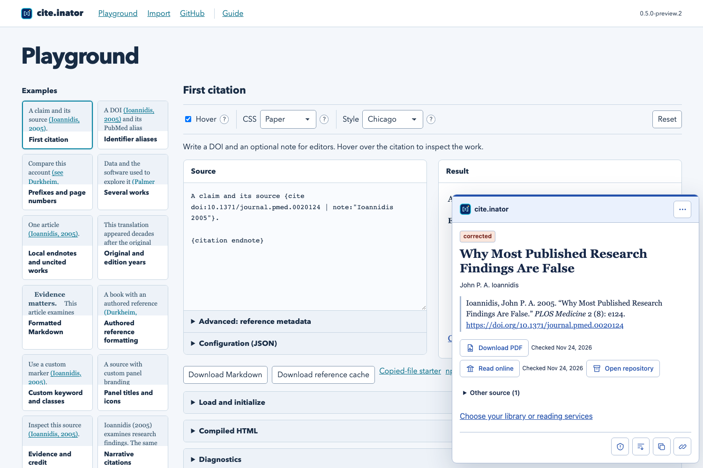

# citation.inator

A small citation library. Write citations in plain text, compile them into linked references and endnotes, and add an optional browser inspector. [Try programmatic citations](#try-programmatic-citations).

**Stable release: 0.3.0 — Editor integration and reader polish.** [Release and downloads](https://github.com/randal-cox/citation.inator/releases/tag/v0.3.0). This branch retains experimental 0.4.0 import work separately.

**0.2.0 — Article tooling.** Editor notes, a site-wide bibliography and tag filters are included in this milestone. See [the milestone record](docs/milestones/0.2.0.md) and [GitHub releases](https://github.com/randal-cox/citation.inator/releases).

## Load and initialize

To serve the demos from the checkout, run `npm start` from the repository root.

**Without npm.** Start with [the standalone demo](https://github.com/randal-cox/citation.inator/tree/main/demos/drop-in), or copy `dist/citation-inspector.mjs`, `dist/citation-inspector.css`, and `dist/LICENSE` into your public assets. The browser uses the two adjacent assets and the compiled page’s JSON cache. Serve them from the same origin over HTTP or HTTPS.

**With npm.** Run `npm ci` and `npm pack` in the downloaded checkout to build the current local tarball. Copy the tarball into your project and run `npm install ./citation-inator-0.3.0.tgz` there for this release. The same browser assets are in `node_modules/citation-inator/dist/`. Import the compiler from `citation-inator`.

```html
<link rel="stylesheet" href="./citation-inspector.css">
<script type="module" src="./citation-inspector.mjs"></script>

<citation-inspector data-cache="./article.html.json" class-prefix="essay"
  panel-title="Source details" panel-icon="/assets/logo.svg"
  evidence-title="Metadata trail" credit-title="Software credits">
  <!-- Insert the compiled article fragment here. -->
</citation-inspector>
```

To write `{ref …}` instead of `{citation …}` and emit classes such as `essay-cite`, set `citationKeyword: "ref"` and `classPrefix: "essay"` when compiling. Match the browser’s `class-prefix` to the compiler’s setting. The browser initializer also accepts `classPrefix`, `panelTitle`, `panelIcon`, `evidenceTitle`, `evidenceIcon`, `creditTitle` and `creditIcon`. [Configuration examples](docs/integration.md#load-and-initialize)

## Try programmatic citations

In the source checkout, run `npm start` and open the [Reading room](http://127.0.0.1:4187/demos/static/#structured-preview) or [Plain HTML](http://127.0.0.1:4187/demos/drop-in/#structured-preview). Open the map and table citations, then use their separate return links from the same reference. Try the unresolved station log and open a citation inside **Map details**. Press Escape twice to see focus return through both layers. The page’s reference links and backlinks also work with JavaScript disabled.

Use `planCitationOccurrences` and `bindCitationTrigger` to add the inspector to app-rendered controls. The example runs alongside the regular compiled citations on both pages. See the [integration guide](docs/integration.md#bind-citations-to-controls-you-render).

## Article editors and a site-wide bibliography

Version 0.2.0 adds source-only `note:"Cox 1995"` metadata, `describeCitation` and `annotateMarkers` editor APIs, and JSON CLI operations to describe, refresh or check notes. Per-item `tags:theory,praxis` contributions are collected with `collectMarkerTags` (or `--collect-tags --json`); the host aggregates and curates record topics. Use `includeDiagnostics: true` in build tools. The self-contained `citation-tools.mjs` also works in a browser without npm.

Compiler results expose actual citation occurrences, including listing-only `nocite` entries. `createSiteOccurrenceIndex` joins those anchors to published page routes; pass the resulting `siteOccurrences` into a bibliography to get static **Cited in** / **Listed in** return links and corresponding inspector sections. Records can carry `tags`, with a `tagCatalogue`, per-list usage overrides, build-time filters and optional keyboard-operated browser filters. `listFilters: { minItems: 6, minTags: 2 }` limits controls to longer multi-topic lists. `inlineTags: "marker"` displays the tags contributed at a particular mention.

Run `npm start` and try [the shared bibliography](http://127.0.0.1:4187/demos/static/bibliography.html) and [editor tools](http://127.0.0.1:4187/demos/static/editor-tools.html). Both examples are also in the standalone folder. See [the complete API, CLI and configuration guide](docs/article-tools.md). Formatted-document import is in [source-only 0.4.0 development](docs/import-development.md); the experimental matcher, text/HTML/Markdown extraction and Crossref bibliographic search are not installed 0.2.0 APIs.

## Reader access and media

Try **Reader access and artwork** in the Reading room or Plain HTML. The built-in settings sheet remembers a reader’s services on this site, prioritizes explicitly open copies, and can use a library proxy or OpenURL resolver. Hosts can replace the settings UI and translate its text. Copied citations keep their canonical bibliographic URL. [Reader access API and wording](docs/reader-access.md)

Artwork and image records support creator attribution, literal date ranges, rights, institutions, accession numbers, contributors, and separate source/served checksums. The demo also shows an inline inspect icon. Custom icons can follow the text colour with `inspectIconMode: "mask"`. [Media fields and style support](docs/media-support.md)

## Write a citation

```text
Empathic concern can deepen partisan polarization {citation doi:10.1017/S0003055419000534}.

{citation evidence} · {citation credit}

{citation endnote}
```



## Compile a page

With Node.js 22 or later, run this command from the downloaded repository. It writes `article.html` and its matching `article.html.json` cache.

```sh
node scripts/compile.mjs --style chicago-author-date --endnotes-heading References \
  demos/drop-in/reading.txt demos/drop-in/citations.json article.html my-article
```

The named styles are `chicago-author-date`, `apa`, `mla`, `harvard` and `vancouver`. Existing integrations can keep the `default` style. For prose that already has markup, install dependencies and use `--format html` or `--format markdown`. For Python and other build tools, `--json` reads a request from standard input and writes one JSON result.

For Chicago author–date, use the same `authors[].id` on variant spellings of one person's name to avoid spurious initials in inline citations. [Chicago author options](docs/integration.md#chicago-names-groups-and-legislation)

Keep the default `suffixScope: "fragment"` for articles with their own reference lists. Use `suffixScope: "cache"` for a work split across pages that share a bibliography. [Year-letter options](docs/integration.md#shared-excerpts-scoped-endnotes-and-reading-lists)

Write `{citation isbn:9780593656433 | prefix:see also | locator:34}` for an affix and locator. Use `citationParts` for editorial italics or bold. Use `originalIssued` and `issued` for the original and edition dates. Use `library` and `full-text` locations for access links. Apply reader preferences with `accessProviders` and `hiddenAccessProviders`. The panel exposes an `open` attribute while visible.

See the [citation-style catalogue and support matrix](docs/citation-styles.md). The development checkout also includes an unreleased host reference-prefix hook and once-per-list access help, documented in the integration guide.

See the [integration guide](docs/integration.md) for HTML and Markdown examples, reused fragments, the Python command, ISBN lookup and title-and-author search, and the browser API. See the [roadmap](ROADMAP.md) for follow-up work.

## Try the import-review development demo

On `codex/citation-import`, run `npm ci`, `npm run build` and `npm start`, then open [Import review](http://127.0.0.1:4187/demos/import/). Choose an example, paste a complete document, or choose/drop a UTF-8 TXT/Markdown file. Raw Document includes its bibliography; edits rebuild references and matches. Format is detected from the source with a manual override. Radio choices update Converted Document live. Download both Markdown and the reference cache for local-ID citations; the original bibliography is preserved.

This development demo requires a local server and saves no documents. Selected references automatically receive Crossref DOI and Open Library ISBN suggestions; known identifiers fetch metadata directly. The compact Lookups left count tracks progress beside Resolve Citations. Strict DOI matches can complete automatically; ISBNs need an edition choice. Manual identifiers and completion without an identifier work offline. Native PDF/Word files and browser-native review/apply remain unfinished. It is not a service in the static ZIP. See [the demo guide](docs/import-demo.md) for boundaries, keyboard controls and limits. Published 0.3.0 artifacts are unchanged.

## Work on the source checkout

Clone the [GitHub repository](https://github.com/randal-cox/citation.inator) and use Node.js 22 or later.

```sh
git clone https://github.com/randal-cox/citation.inator.git
cd citation.inator
npm ci
npm run build
npm test
```

Run `npm start` to open the [reading room](http://127.0.0.1:4187/) and find the notation guide and Resolution bench. The reading room’s **CSS** and **Style** selectors preview appearance and citation formatting separately. The help buttons beside **Hover**, **CSS**, and **Style** show the corresponding configuration. `npm run test:browser` runs the browser checks with a local Chrome installation. Run the [adversarial review](https://github.com/randal-cox/citation.inator/blob/main/docs/adversarial-testing.md) at every milestone and when a change warrants it.

Before a check-in, follow the [check-in procedure](docs/checkin-procedure.md) and review the milestone record and roadmap. Install the local staged-check hook with `npm run hooks:install`. Use `npm run checkin:check` for the fast checks and `npm run milestone:check` when closing a milestone.

## Credit and license

Randal Cox maintains citation.inator. [ORCID](https://orcid.org/0009-0002-3427-7190) · [GitHub repository](https://github.com/randal-cox/citation.inator)

The software uses the MIT license. The optional tools bundle includes parser dependencies with their own notices, retained in its header and [THIRD_PARTY_LICENSES.txt](dist/THIRD_PARTY_LICENSES.txt). Third-party source material retains its own terms. See [CITATION.cff](CITATION.cff) for the software citation and [CHANGELOG.md](CHANGELOG.md) for release changes. Source records carry their own attribution.
