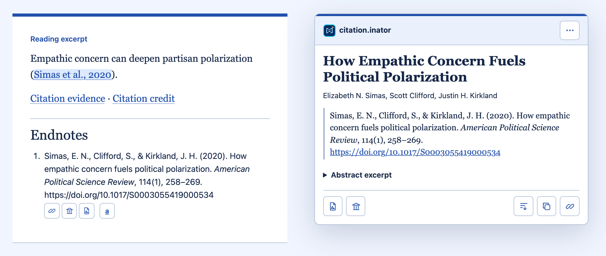

# citation.inator

A small citation library. Write citations in plain text, compile them into linked references and endnotes, and add an optional browser inspector.

## Load and initialize

To serve the demos from the checkout, run `npm start` from the repository root.

**Without npm.** Start with [the standalone demo](https://github.com/randal-cox/citation.inator/tree/main/demos/drop-in), or copy `dist/citation-inspector.mjs`, `dist/citation-inspector.css`, and `dist/LICENSE` into your public assets. The browser uses the two adjacent assets and the compiled page’s JSON cache. Serve them from the same origin over HTTP or HTTPS.

**With npm.** Run `npm ci` and `npm pack` in the downloaded checkout to build the current local tarball. Copy the tarball into your project and run `npm install ./citation-inator-0.1.3.tgz` there. The same browser assets are in `node_modules/citation-inator/dist/`. Import the compiler from `citation-inator`.

```html
<link rel="stylesheet" href="./citation-inspector.css">
<script type="module" src="./citation-inspector.mjs"></script>

<citation-inspector data-cache="./article.html.json" class-prefix="essay"
  panel-title="Source details" panel-icon="/assets/logo.svg"
  evidence-title="Metadata trail" credit-title="Software credits">
  <!-- Insert the compiled article fragment here. -->
</citation-inspector>
```

To write `{ref …}` instead of `{citation …}` and emit classes such as `essay-cite`, set `citationKeyword: "ref"` and `classPrefix: "essay"` when compiling. Match the browser’s `class-prefix` to the compiler’s setting. The browser initializer also accepts `classPrefix`, `panelTitle`, `panelIcon`, `evidenceTitle`, `evidenceIcon`, `creditTitle` and `creditIcon`. [Configuration examples](docs/integration.md#load-and-initialize)

## Write a citation

```text
Empathic concern can deepen partisan polarization {citation doi:10.1017/S0003055419000534}.

{citation evidence} · {citation credit}

{citation endnote}
```



## Compile a page

With Node.js 22 or later, run this command from the downloaded repository. It writes `article.html` and its matching `article.html.json` cache.

```sh
node scripts/compile.mjs --style chicago-author-date --endnotes-heading References \
  demos/drop-in/reading.txt demos/drop-in/citations.json article.html my-article
```

The named styles are `chicago-author-date`, `apa`, `mla`, `harvard` and `vancouver`. Existing integrations can keep the `default` style. For prose that already has markup, install dependencies and use `--format html` or `--format markdown`. For Python and other build tools, `--json` reads a request from standard input and writes one JSON result.

For Chicago author–date, use the same `authors[].id` on variant spellings of one person's name to avoid spurious initials in inline citations. [Chicago author options](docs/integration.md#chicago-names-groups-and-legislation)

Keep the default `suffixScope: "fragment"` for articles with their own reference lists. Use `suffixScope: "cache"` for a work split across pages that share a bibliography. [Year-letter options](docs/integration.md#shared-excerpts-scoped-endnotes-and-reading-lists)

Write `{citation isbn:9780593656433 | prefix:see also | locator:34}` for an affix and locator. Use `citationParts` for editorial italics or bold. Use `originalIssued` and `issued` for the original and edition dates. Use `library` and `full-text` locations for access links. Apply reader preferences with `accessProviders` and `hiddenAccessProviders`. The panel exposes an `open` attribute while visible.

See the [integration guide](docs/integration.md) for HTML and Markdown examples, reused fragments, the Python command, ISBN lookup and title-and-author search, and the browser API. See the [roadmap](ROADMAP.md) for follow-up work.

## Work on the source checkout

Clone the [GitHub repository](https://github.com/randal-cox/citation.inator) and use Node.js 22 or later.

```sh
git clone https://github.com/randal-cox/citation.inator.git
cd citation.inator
npm ci
npm run build
npm test
```

Run `npm start` to open the [reading room](http://127.0.0.1:4187/) and find the notation guide and Resolution bench. The reading room’s **CSS** and **Style** selectors preview appearance and citation formatting separately. The help buttons beside **Hover**, **CSS**, and **Style** show the corresponding configuration. `npm run test:browser` runs the browser checks with a local Chrome installation. Run the [adversarial review](https://github.com/randal-cox/citation.inator/blob/main/docs/adversarial-testing.md) at every milestone and when a change warrants it.

## Credit and license

Randal Cox maintains citation.inator. [ORCID](https://orcid.org/0009-0002-3427-7190) · [GitHub repository](https://github.com/randal-cox/citation.inator)

The software uses the MIT license. Third-party source material retains its own terms. See [CITATION.cff](CITATION.cff) for the software citation and [CHANGELOG.md](CHANGELOG.md) for release changes. Source records carry their own attribution.
